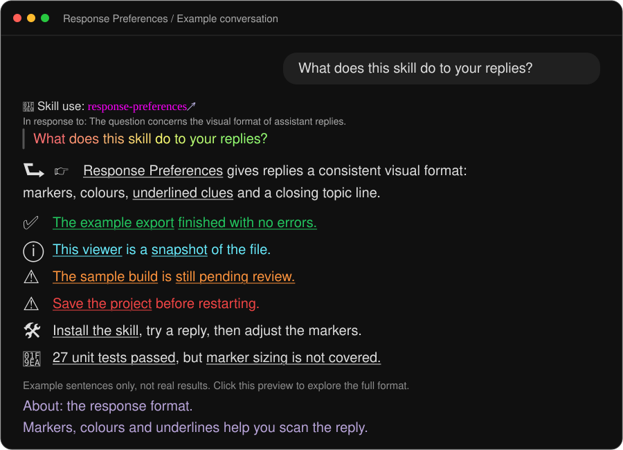

# Response Preferences<br>⮑ 🛠️ 🧪 🖥️ ✅ ❌ 👀 🐌 🐞 ⓘ 👉 🫵 🤨 ⚠️ ❓ 💡 ⚖️ ⛔❗ 🧠 ➕➕❗

[](https://ethansk.github.io/response-preferences/)

A personal Codex skill for **how replies are written**. Fixed emoji meanings, coloured highlights, underlined scanning cues, original-message context, and a local Markdown/code editor.

**[Try the website](https://ethansk.github.io/response-preferences/)** · **[Try the editor](https://ethansk.github.io/response-preferences/viewer.html)** · **[Read the skill](SKILL.md)**

Created from Ethan's preferences, shared so you can use or adapt them. The website presents the examples inside a smaller Codex-style window on a macOS desktop: a task sidebar, compact title bar, centered conversation, source/details panel and bottom composer. It is an independent, interactive demonstration—not the Codex app—and does not run an AI.

Six example conversations introduce the skill, guide installation and customisation, explain the response format, demonstrate file/context links, and show successful and failed tasks. Together they demonstrate all 20 global markers, the full colour palette, underlined scanning clues, quoted questions and closing topic reminders. The home chat previews the full range straight away: working and final markers, all 20 meanings, colours, underlines, section carets, tables, file and message links, annotations and optional notification summaries. The guide sits on a macOS Tahoe desktop with Ethan’s app icons and menu-bar apps recovered from his ultrawide reference. Dock icons open each app’s public website; menu-bar app icons open Menu Bar Dock, which supplies the app strip. Hover or focus an icon to see its destination. The **Apps in this setup** directory keeps every app reachable on small screens and links the wallpaper. Personal folders and the local-only media-key helper are omitted. The window has standard macOS traffic lights, reversible preview controls and keyboard-accessible navigation. Click a marker for a compact explanation that keeps the chat in place, or open a file in the working Markdown/code editor. Copy an installation prompt, manual commands or a question for your own agent; this website does not contact a model or install anything itself.

This is a set of agent instructions with helper scripts, not a modification of the Codex app. It cannot guarantee that a model always follows the format.

## What it does

| Feature | Behaviour |
| --- | --- |
| Every question answered | Checks every distinct meaningful ask, including earlier unanswered follow-ups, against the actual draft. Prefers several small answer blocks, each with a visible rainbow question and enlarged reply arrow; groups only questions that genuinely share an answer. Below About, the final reply reports scoped question coverage. Counts are semantic checks, not automatic inference or a guarantee of model obedience. |
| Working versus final replies | Working updates use normal-size markers, including 🧠, and short underlined cues; a ⮑ answer aimed at you stays large so it stands out. Final replies use enlarged markers, selected colour and underlined scanning cues. |
| Deterministic markers | Uses a closed vocabulary: the same marker always means the same thing. Only user-approved project mappings may extend it; no arbitrary emoji additions. |
| Meaningful emphasis | Red for critical text, green for confirmed success, orange for warnings, cyan for important information. Every coloured highlight makes sense on its own from its first word, using enough subject and context—even a complete short sentence. Highlight selectively; cyan does not colour a whole information section. |
| Other-model contributions | Each other-model invocation gets a short cyan `Models:` sentence once at its start and once at its end, naming the model and its role; repeated progress/polling updates and later reuse of the same result omit it. Chat-only work omits it. The line precedes required final footers and the lavender About reminder, and does not authorize model calls. |
| Closing topic reminder | Only the final assistant reply ends with a muted-lavender (`#b8a4d9`) `About:` reminder and the question-coverage line immediately below it. Working commentary, progress updates and skill announcements have neither footer; each final reply closes one message window. The relevant questions above the answers stay in place. |
| Specific waiting conditions | Names the app and actual condition, such as “when Agent Flow isn’t recording”, instead of saying only “a safe moment”. Distinguishes the requirement from a check that already passed. |
| Skim reading | Lets the agent choose which words to underline and how much emphasis suits the response. The goal is to convey important details when skimming, with density determined by the content. Useful verbs, negatives and conditions keep the cues coherent; even a short progress update should retain its useful outcome, wait or next action when read only through its scanning cues. Exact quotes, code and links remain intact. |
| Computer Use | 🖥️ for manual browser/app interaction and every Manual checks section, with explicit status wording. Manual checks only lists what the agent actually checked or tested. Checks for you to run go under a separate Manual checks for you heading, marked 🖥️🫵 together. Successful manual tests may use green; automated tests and lint remain ordinary text. |
| Added beyond your request | ➕➕❗ marks work added beyond what you asked for. Each item starts with a score out of ten, such as `(7/10)`, for how much it matters to look at: 1–3 small and safe to skip, 4–6 worth a glance, 7–10 changes behaviour, cost, data, security or another surface, or is large. The score is the agent's judgment, not your approval, and never replaces the disclosure. |
| Project extensions | Additional user-approved mappings apply only in their project; global meanings stay consistent. |
| Context above answers | Shows a short question reminder in a rainbow blockquote, naming the subject when dictated pronouns would be unclear later, above the direct-answer arrow, in main and side chats, alongside applicable annotation context; read-only side chats use the existing helper without updating shared state. The reminder can retain around 60–80 visible characters and wrap naturally; a fixed 24-colour cycle keeps agents from reinventing the format. |
| Original-message links | Opens a document headed **Your message** with the exact original wording and attached images underneath. |
| Clickable references | Links skills, files and specific passages. Colour stays outside the adjacent ↗ link. |
| Answer context | Each distinct answer has its own visible rainbow question above ⮑. A one-character ↗ hover link is optional when a longer original excerpt helps; questions are not hidden in it. |
| Markdown viewer | One shared live viewer reads original Markdown/code files, with line highlighting, automatic refresh and conflict-aware saves. Passage links use a freshly verified range matching the file and lines being explained. |
| Code editor | CodeMirror provides syntax highlighting, line numbers, search/replace, undo/redo and bracket matching. Preview, edit and split views. |
| Scannable tables | Colours important rows using the existing meanings: cyan for useful highlights, red for critical errors, orange for caveats and green for confirmed success. Underlines key words, keeps routine rows neutral and wording short, and uses approved category markers when helpful. |
| Annotation context | Adds a standalone **Problem at hand** unless the rainbow question already explains the situation from first principles. Uses a substantive sentence, or a little more, to explain the system, the issue and why it matters. **Earlier response** and **Your annotation** remain optional for useful comparisons. Quoted context stays faithful to its real source; reading-only highlights do not become extra questions. |
| Notification wording | Defines short, complete notification summaries. Native notification delivery is an optional **separate** integration. |

The response-preference skill itself is used silently. Other skill announcements use 🧠 with a magenta skill name and an adjacent opening link.

## Install

On the [website’s installation walkthrough](https://ethansk.github.io/response-preferences/#setup), choose **Copy installation prompt** and paste it into your Codex task. The prompt asks your agent to check for an existing installation, preserve local edits, add the activation line without duplicating it and demonstrate the installed format. You can also [read the exact prompt](docs/install-prompt.txt) or install manually below.

Requirements: Codex with local skills support and **Python 3.9+** for live viewers and message-context files on macOS/Linux. The built viewer is included; no Node installation or build step is needed to use it.

```sh
git clone https://github.com/EthanSK/response-preferences.git ~/.codex/skills/response-preferences
```

Use your configured Codex home instead of `~/.codex` if different. If that destination already exists, preserve it and compare your changes before installing; the clone command deliberately fails rather than replacing it.

Add this instruction to your global or project `AGENTS.md`:

```text
Use $response-preferences for all replies.
```

You can also invoke `$response-preferences` explicitly. Start a fresh task if an already-running task retains earlier instructions. The formatting defaults follow Ethan's choices; edit `SKILL.md` to change them for yourself. LaTeX appearance and file links depend on the chat client's renderer.

When maintaining Ethan’s skill, check the website and README after every response-style change, update affected examples, validate, commit and push to the public repository. Other users should use their own authorised fork. Publishing is part of the same task, without a separate sync request. Compare the installed rules and public checkout before finishing, reconcile shared changes using the latest preferences, and verify the new remote commit and deployment. This is an agent workflow, not a background auto-publisher; private local integrations stay local.

For updates, use `git pull --ff-only` only after reviewing your local edits. Keep personal overrides on your own branch or fork. Do not discard customised preferences to update.

Orange warnings explain the affected feature, expected and observed behaviour, practical impact, and whether the issue is confirmed or pre-existing. Routine details stay less prominent. Review replies append verified Codex/Opus finding counts to the existing cyan Models line; shared findings are counted once and withdrawn findings are separated.

## Marker vocabulary

| Marker | Meaning | Marker | Meaning |
| --- | --- | --- | --- |
| ⮑ | Direct answer | ⓘ | Information |
| ✅ | Confirmed success | ❌ | Failure |
| 👀 | Starting an inspection | 🐌 | Work actively in progress |
| 🐞 | An actual bug | 🫵 | Your action or decision |
| 🤨 | Unexpected behaviour | ⚠️ | Caution |
| ❓ | Missing information | 💡 | Recommendation |
| ⚖️ | Trade-offs | ⛔❗ | External blocker |
| 🧠 | Skill use | ➕➕❗ | Added beyond your request |
| 🖥️ | Computer Use, manual browser/app tests and Manual checks the agent ran | 👉 | Main takeaway |
| 🛠️ | Planning and brainstorming | 🧪 | Tests |
| 🖥️🫵 | Manual checks for you to run | | |

Test-related information uses **🧪**: setup, coverage, progress, results and limitations. State the actual status in words; the icon does not mean a test passed. Automated results remain uncoloured. **🖥️** still marks actual Computer Use/manual browser or app tests and every Manual checks section of checks the agent ran; **🖥️🫵** marks only the Manual checks for you heading, and **🐞** still reports actual bugs.

Planning and brainstorming share **🛠️**: exploring options, proposing an approach and outlining next steps. Use it instead of information for plans; **🐌** remains execution underway and **💡** remains a recommendation. For example: `🛠️ Install the skill, try it on a real reply, then change the markers to suit you.`

Markers stay inline for a single line or short statement. A multi-block section starts with a marker and a visible ⌄ chevron; start another when the purpose changes. In final replies, use `\(\huge\text{ⓘ}\) \(\raisebox{0.3em}{\Large\text{⌄}}\)`, keeping the chevron smaller and raised. Working commentary uses normal-size markers, except a direct answer uses `\(\huge\text{⮑}\)` in both phases. Each distinct answer gets its own visible rainbow-question blockquote followed by its enlarged arrow and opening answer on one line. Prefer several small answers over one long answer; bundle only questions that genuinely share an answer. Hover links and full annotation-context blocks are optional when they help. Table-cell labels remain normal size. Answers name their subjects so they make sense even when the question is skipped.

Read each highlighted clause or sentence on its own: it should make sense without the uncoloured words before or after it. This applies to all four highlight colours; magenta skill names keep their separate name-only styling.

Codex treats each inline LaTeX expression as an unbreakable box. Ethan verified continuous selection in one coloured expression, then showed that whole-paragraph boxes still overflow. Underlines did not give him whole-line triple-click selection, so do not put their surrounding sentence or paragraph inside another LaTeX wrapper just for grouping. Red raw commands can come from missing closing braces, math delimiters, or unescaped literal characters; the sans-serif/underline combination is valid. Working and final replies keep the short, complete `\underline{\textsf{...}}` cue: its inner `\textsf` provides the preferred font. Colour and About use separate short expressions. Keep each expression below 64 approximate visible characters. The generated rainbow question is a separate helper-produced exception.

Ordinary symbols, percentages and dollar prices are allowed and stay visible. The agent handles escaping inside short underlines, colours and About text: `10\%`, `\$500`, `C\#`, `sample\_tool` and `A \& B`. Outside LaTeX, ordinary Markdown keeps `10%` and `$500` unchanged. Do not omit a symbol, change a value/currency or require rewording to avoid formatting. A bare `%` starts a TeX comment and can hide the remaining text and closing braces. Use [the compact symbol lookup](SKILL.md#keep-literal-symbols-visible) for literal braces, tildes, carets and backslashes; escape inserted text once, not commands, structural braces or colour arguments.

```latex
\(\underline{\textsf{10\% cheaper than Balanced}}\)
\(\underline{\textsf{about 20\% lower compute-plus-transfer cost}}\)
\(\underline{\textsf{Pro \$500 upgrade grants access}}\)
```

Start with the [copyable colour patterns](SKILL.md#copy-these-exact-colour-patterns): a cue uses `\(\underline{\textsf{short clue}}\)`, colour uses `\(\textsf{\color{#67e8f9}A complete short fact.}\)`, and About uses the same simple form in lavender. Every opening `\(` needs its closing `\)`; the closing braces alone do not finish the expression. Check the actual authored draft before sending. The checker remains an optional diagnostic for tricky expressions or skill maintenance. It validates syntax with bundled KaTeX but cannot guarantee agent obedience or the app’s layout. Each answer keeps its visible rainbow question; labelled annotation context and hover links are optional when useful. Automatic reply repair is not used.

A compact coloured table value is `\(\textsf{\color{#67e8f9}100\%}\)`. The colour code's group is already closed, leaving just one closing brace after the value. An underline instead ends with two braces, closing its text and underline groups. Keep these complete templates distinct; percentages and colour-code hashtags remain supported.

Selected final highlights use `\textsf{\color{#hex}...}` with red `#ef4444`, green `#22c55e`, orange `#fb923c`, or cyan `#67e8f9`. Skill names use upright serif magenta as a deliberate exception. Colours appear outside links because some Codex renderers expose raw LaTeX when it is used as a link label.

Use cyan selectively for **useful explanations of what changed or how the resulting system behaves**, including the main explanation in an opening direct answer after ⮑ or 👉. For example, “Both Playlist types share one visual row” is cyan; “The clipping bug is fixed” is an explicit confirmed success statement and is green. A completion reply does not make every descriptive sentence green. Keep each highlight short and understandable on its own.

Final successful completion statements use green, including **committed, merged, saved and deployed**. Colour the short confirmed outcome itself, not only its tick. Automated test results, lint and other routine automated checks do not get green text. Successful manual tests can use green with 🖥️; failed or incomplete manual tests state that outcome without green. The computer marker takes precedence over generic progress/result markers in Computer Use sections.

Projects can list additional user-approved emoji meanings in their existing instructions. Apply only the relevant project’s mappings; do not invent any or override global meanings without explicit approval. Pass approved extra symbols to the reply checker with repeatable `--approved-project-marker` flags. 🖥️ is global.

## Underlines for scanning

When important words are bold, underline those same words too: bold alone is not a scanning cue. This applies to opening answers, conclusions, list lead-ins and test-result totals. Use a plain short underline if bold adds nothing. Check the actual explanatory body for important details that lost useful underline cues; labels or a footer alone do not make the explanation skimmable. This is a judgment-based draft check, not a quota or mandatory checker run. Exact quotations, code, paths and link labels keep their original formatting.

```latex
\(\underline{\textsf{\textbf{Neither automatically wins}}}\)
```

In each working or final reply, underline at least the most important point so the response that matters most is immediately visible. Let the agent decide which words to underline and how much emphasis suits the rest of the reply. The goal is to convey the important details someone skimming needs: the main answer, meaningful results, relevant caveats and next actions. Let the content determine the amount, with no fixed quota per sentence or paragraph. Choose phrases that make sense together, including useful subjects, verbs, negatives and conditions. For example, “audit covers every enabled API’s visible quotas” conveys a claim with its subject and action. Underlines and self-contained colour highlights both support this reading goal. Exact quotations, code, paths and link labels stay intact.

Write the surrounding sentence as ordinary Markdown. For example: `The backup is \(\underline{\textsf{not uploaded}}\).` or `The \(\underline{\textsf{review needs a project}}\) written in` `C#`. Colour highlights use a separate short expression; keep both forms short and fully closed. The website displays underlined cues; never paste raw `<u>` tags into an assistant reply.

## Open a live file viewer

Drag table header dividers to resize columns; double-click to reset. This changes only the view, not the Markdown source.

```sh
python3 ~/.codex/skills/response-preferences/scripts/create-viewer.py /absolute/path/to/document.md --line 45
python3 ~/.codex/skills/response-preferences/scripts/create-viewer.py /absolute/path/to/code.ts --line 65 --end-line 85
```

The command prints a stable local URL. One shared viewer reads the original file, refreshes clean views after external edits, and saves edits back to that file. Unsaved work survives an external change; stale saves are rejected. The real path appears in the header. Skill metadata starts expanded. Whole-file links have no yellow selection; explicit line jumps highlight the requested passage. Code links can highlight an inclusive range with `--line` and `--end-line`, including every selected line's gutter. No document-specific HTML is created.

When the agent points out specific text to inspect, the link highlights that passage in the original Markdown or code, including progress replies and read-only audits. Code, comments, specs and skills all use the reader’s highlighted line or range link. Underlining the reply or supplying an ordinary file-and-line link does not replace this source highlighting.

The loopback-only service starts automatically. On macOS it is a user LaunchAgent, so links continue working after login. Only files registered by the local helper are accessible; there is no arbitrary-path web endpoint. No document data goes to an external service. [File access, installation and export details](references/viewer.md).

Use `--snapshot` only for an intentional standalone export, or `--public --output /absolute/new.html` for a synthetic/public demo. These are explicitly frozen exports, not another editable source.
For original-message context, create JSON containing `text` and optional `images` (absolute paths), then run:

```sh
python3 scripts/create-reply-context.py /absolute/message.json /absolute/new-context.md
python3 scripts/create-viewer.py /absolute/new-context.md
```

The context helper preserves exact message text and copies available attachments so temporary clipboard paths can expire without breaking earlier links. Keep the context source for the task's lifetime; its live link reads that source.

## Editing and privacy

- The viewer is a compact utility: file name and save state in the header, a Preview / Edit / Split control, a line field, icon actions (Search, Open file, Save, Download copy, Light / dark; each names itself in a tooltip and to assistive technology), and a status bar at the bottom for messages. New local viewers use your saved Codex appearance colours, contrast, fonts and light/dark mode. The default dark palette is Linear Dark, with offline Inter typography and matching code colours. The toggle switches light/dark; public demos use the default palette and omit local settings. Existing HTML snapshots keep their original theme.
- **Download copy** exports the edited source. It does not overwrite the original.
- **Open file** lets you choose a file on disk. Browsers supporting the File System Access API can then enable **Save** for that picked file. Otherwise, download the copy.
- Saving checks for external edits first and refuses a conflicting write. This is not an atomic lock against other applications; use a copy for files being edited concurrently.
- Unsaved edits get an indicator and navigation warning. Browser policies can suppress unload prompts; save or download before closing.
- Normal local links use a loopback-only file service. Document contents stay on your machine; no analytics or external uploads. HTML in Markdown is escaped and remote images do not load. The public demo remains a browser-only synthetic snapshot.
- A generated HTML file **contains its document text and any embedded images**. Keep it private when its source is private. `--public` removes local image/link embeddings; it does not redact the source text.
- Text is limited to 5 MB. PNG/JPEG/GIF/WebP images can be embedded up to 20 MB each, 40 MB total. Complex image destinations and local links are best effort. Linked Markdown trees are not recursively copied.
- The editor highlights Markdown, JavaScript/TypeScript/JSX, Python, JSON, HTML, CSS, SQL, YAML, shell, Rust and Go. Other text opens without language-specific highlighting. Explicit line jumps softly highlight the complete block in yellow, with a thin yellow gutter line separated from the content, without a wider gutter; whole-file links start unselected. There is no code execution, terminal or language server.

See [viewer instructions](references/viewer.md) for details. User clicks and automated browser access have separate permissions: an automation restriction does not mean a local link is broken.

## Optional notifications

Notification titles always match the exact current Codex chat name, including its existing emoji. The sender reads the name at delivery, so renaming a chat changes the next notification automatically. The text below pairs the status icon with a brief answer summary. The native integration measures the body against a two-line budget; it never shortens the chat name to fit. macOS may visually truncate a long title. Metadata stays out of chat. This repository does **not** install notification hooks, a native sender, task routing, or display-duration changes. On Ethan's Mac those are provided by a separate `macos-heads-up-notification` integration. Without it, the agent skips notification preparation. All other features work independently.

## Keeping the format consistent

The everyday pattern is deliberately small: write normal Markdown, use `\(\underline{\textsf{a useful clue}}\)` in working and final prose, and use `\(\textsf{\color{#67e8f9}A complete short fact.}\)` for a selected colour highlight. Leave surrounding prose, links, code and technical names in Markdown so they wrap naturally. Keep `\textsf` inside the short underline cue and in separate colour and About expressions. The final `About:` reminder and generated rainbow question retain their own fixed patterns.

The bundled checker remains available when diagnosing a tricky expression or maintaining the skill:

```sh
python3 ~/.codex/skills/response-preferences/scripts/check-reply.py /absolute/reply.md
```

It checks mechanical syntax and some structural rules. It is not a required action before every reply, nor proof that the app rendered the message correctly. The earlier brace error was caught by the checker when tested later; the assistant had not checked that outgoing reply. The skill therefore reduces the amount of LaTeX the agent writes rather than depending on a check it might skip. See [verification and coverage](references/verification.md).

In the Claude desktop app, add `--claude-render` to check only whether each expression will render there. Claude shows an expression as raw text when it runs over 200 characters, contains `$` even escaped as `\$`, or touches the preceding word. Write a price inside an expression as `\textdollar{}500` there, and generate rainbow reminders with `rainbow-quote.py --claude`.

GitHub Actions runs the test suite on every push and pull request, including regression cases for the reply checker and the website's marker, colour, quote and skill-link presentation.

The always-read skill is a compact core; [the detailed reference](references/style-reference.md) retains the complete preferences. Read the core separately and retrieve missing ranges if a tool truncates it. Reread at task start, after compaction or a style correction, at least every 10 assistant messages (including commentary), and immediately before each final reply. Track the count through long waits, progress updates and workstream changes; reading another skill or moving into data operations does not reset it. Check this interval before each short status reply, including while waiting on CI. Refresh before the first explanation of a newly discovered failure, and before replying if the count is uncertain. Review replies also refresh the installed global and project review contracts. This is an agent instruction, not a background counter or a guarantee of model obedience. For an Agent Flow annotation without a native reference, `check-reply.py reply.md --require-annotation-context` diagnoses missing or late context fields before the first answer.

Test status follows the evidence from the actual runner. A CI step named “Run tests” may still be preparing credentials or selecting cases; report preparation until the runner records a test start.

Automatic reply repair is not part of this workflow. Follow the simple complete patterns; use the draft checker only when a diagnostic helps. The old guard and exemption helpers were removed; do not add a completion-hook repair or wake another task to fix formatting.

## Develop

Node.js 22+ and Python 3.9+:

```sh
npm ci
npm run check
```

`src/` holds the editor, styles and HTML shell. `npm run build` produces the self-contained `assets/viewer.html` template. Tests cover source preservation, Markdown line mapping, active-content rejection, generator boundaries, and editor interaction/state.

The simple public site is in `docs/`, served by GitHub Pages from `main:/docs`. Rebuild public demos with `python3 scripts/build-demos.py` after changing the skill or viewer. Public examples are synthetic; never add actual conversations, clipboard images, home-directory paths or generated private viewers to this repo.

## Licence and dependencies

MIT. CodeMirror, markdown-it, Highlight.js and their dependencies retain their own MIT licences. The included bundle contains third-party code; see [THIRD-PARTY-NOTICES.md](THIRD-PARTY-NOTICES.md). This project is independent of OpenAI and is not an official Codex feature.

## Weekly update checks

The agent checks the configured public source on first skill use when a week has passed, using a shared local lease to avoid duplicate checks. When an update is available, it explains the changes and asks if you want it first. It installs only after you agree, preserves local edits and respects opt-outs. Declining or ignoring the offer leaves your installed skill unchanged. No background process is installed. Python 3 is needed for the date/lease helper; the skill can still be used without it. Copied installations need a trustworthy installation baseline; plugin installations use their host updater. See [the update procedure](references/public-updates.md).

## A pointer in the final reply

Only the final reply includes an attention finger: normally one, leaning towards 🫵 when something is needed from you or it is your turn next, and towards 👉 when it is mainly “here is the main information”. These are preferences to guide the choice, not absolute rules. Two may help for distinct important items. Working commentary and progress updates have no attention fingers, so they do not steal your focus. Keep the finger beside its content, not isolated at the bottom. Other status markers keep their meanings.

Only the final assistant reply closes with an About reminder, followed by question coverage. Working commentary, progress updates and skill announcements have neither footer. The reminder names what we are doing and adds useful context. For example: **About: fixing the video export. Restart the app, then retry the clip.** Keep it concise, but let it wrap rather than squeezing it into one line.

Use short selectable lavender chunks when needed: `\(\textsf{\color{#b8a4d9}About: fixing video export.}\)` `\(\textsf{\color{#b8a4d9}Restart the app, then retry the clip.}\)`. Keep each chunk within the 64-character guardrail. Immediately below, write `Coverage since last final reply: 2 user messages; 3/3 requests and steers addressed.` The message window starts after the previous assistant final reply and includes subsequent interruptions and corrections; commentary does not reset it. Count only that window, not an arbitrary slice of task history. Privately map each addressed item to actual text in the final reply; one answer can cover several asks, but accumulated task totals and silently followed constraints are not extra answers. An explicit unknown is addressed, not proof of completed work. Keep older unfinished work tracked separately. Required project footers keep their established position after this pair.

Closing outstanding-item recommendations include a hover-only ↗ whose destination text gives the fuller explanation; it is deliberately not a working file link. Env footers are reserved for AIMVS work, not unrelated tasks.

## Original-message hover

Clarify a term or limitation where it first appears, including in annotation answers. A later section can add detail, introduced with “More clarification below”, but must not supply an explanation needed to understand the earlier answer. For example: “The panel stays attached — Angular can still update it while it is hidden; its subscriptions need their own pause. More clarification below.”

Separate distinct annotation answers with a Markdown horizontal divider (`---`), including Agent Flow selections. Keep a section's full context, short rainbow question and answer together; related annotations can share one answer. The website example shows two annotation answers with this divider.

Prefer Codex’s native `:codex-annotation{index="N"}` reference for an actual attached response annotation. It shows the selected text and the user’s comment on hover, so no fake file-path link is needed for that annotation. Its index must point to an annotation supplied with the message; it cannot be used to attach arbitrary message text. The ordinary-message fallback below remains useful when there is no supported native reference.

The quoted question can use `[↗](</Original user text here>)` to show the original text in Codex’s destination popup. This user-confirmed short-text technique includes a leading slash and is hover-only: clicking does not open a file. Keep a separate real context-viewer link for attached images or clickable context. Escape internal angle brackets and backslashes rather than deleting them. For tricky source text, `python3 scripts/hover-link.py question.txt` emits a safe Markdown link; pass several files together to batch the work. Markdown parser tests verify intact links and preserved source text, including type expressions, entities and URL punctuation. Native popup appearance for those cases remains separate verification. Use the real context viewer for multiline/control-character text or a native popup that does not preserve the original.

The example sidebar includes a [numbered separator chat](https://ethansk.github.io/response-preferences/#separator), showing how Ethan uses a pinned task with a dashed name to visually separate groups of chats.

## Rainbow question reminders

The short quoted question above each answer uses a fixed 24-colour cycle, including pink between violet and red. These colours identify your words; status highlights in the answer retain their own meanings. Each new quote starts one position further along that fixed cycle. The helper advances a small shared local counter, wrapping after 24; a lock protects simultaneous tasks. The counter stays outside the public skill, and retries reuse the same generated quote. The reminder favors wording that names what you were talking about. It keeps your meaning and perspective, and can lightly rephrase an unclear pronoun using the subject established by the prompt and nearby context: `Can we pause the whole hidden component at once?` is clearer later than `if it's like a one-time thing`. Exact original wording stays in the annotation context and source. The reminder is usually around 60–80 visible characters when that much relevant wording exists, with a maximum of 80. Short questions stay short; longer reminders wrap naturally in chunks of at most 64 visible characters. Every word advances one colour. Full annotation/evidence blocks remain unchanged.

[Copy the exact recipes and different-length examples](references/format-recipes.md), or run `python3 scripts/rainbow-quote.py question-1.txt question-2.txt` to generate renderer-checked blockquotes from one or more plain-text excerpts. Multiple files are handled in one process and receive consecutive starting colours. The recipes also settle recurring choices for success versus information, test results, final pointers, punctuation and About reminders.
